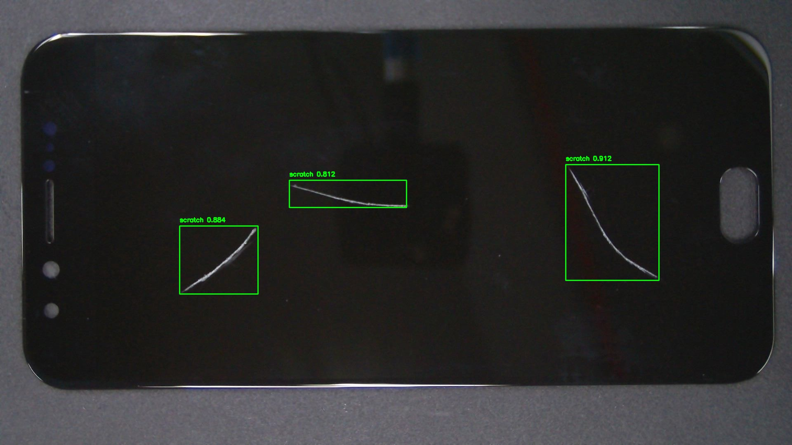
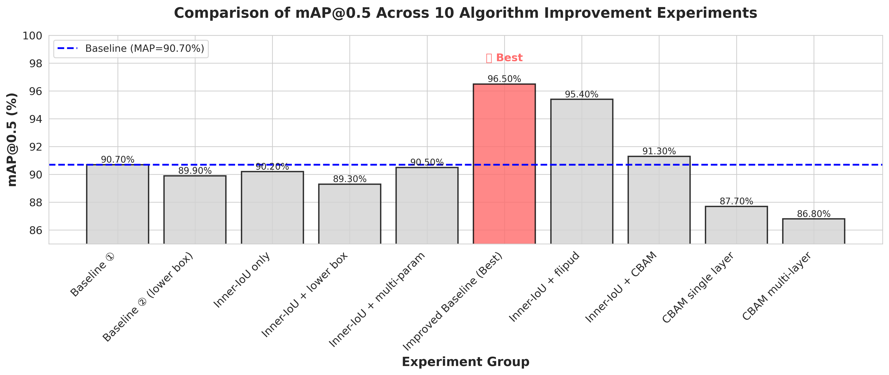
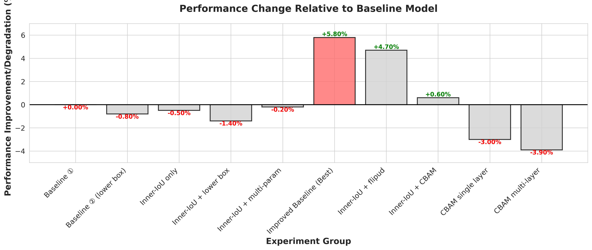

# Phone Defect Detection & Intelligent Grading System

> **基于改进 YOLOv11 的二手手机外观瑕疵检测与智能定级系统**
> An end-to-end deep-learning system that detects appearance defects on
> second-hand smartphones and automatically assigns a quality grade with
> an estimated resale price.

[](https://www.python.org/)
[](https://fastapi.tiangolo.com/)
[](https://docs.ultralytics.com/models/yolo11/)
[](https://onnxruntime.ai/)
[](https://developers.weixin.qq.com/miniprogram/dev/framework/)
[](LICENSE)

## Demo



*The model detects three scratches on a phone screen with confidence scores of 0.88–0.91. Green bounding boxes show precise localization.*

---

## Table of Contents

- [Demo](#demo)
- [Overview](#overview)
- [Key Features](#key-features)
- [System Architecture](#system-architecture)
- [Model & Algorithm Highlights](#model--algorithm-highlights)
- [Experiment Results](#experiment-results)
- [Tech Stack](#tech-stack)
- [Project Structure](#project-structure)
- [Quick Start](#quick-start)
- [API Reference](#api-reference)
- [Grading Algorithm](#grading-algorithm)
- [Training & Customization](#training--customization)
- [Future Work](#future-work)
- [License](#license)

---

## Overview

The second-hand smartphone market suffers from **subjective and inconsistent
quality grading** — buyers and sellers often disagree on whether a scratch is
"normal wear" or "significant damage," leading to disputes and price
inefficiency.

This project provides an **objective, AI-driven grading pipeline**:

1. Capture photos of the phone from multiple angles (front, back, sides).
2. An improved **YOLOv11** model detects four defect categories:
   **scratch, bump, paint loss, and crack**.
3. A **weighted scoring algorithm** aggregates defects across all views,
   penalizing severe defects (cracks) more heavily than minor ones
   (fine scratches), and weighting the front face more than the back.
4. The system outputs a **grade (S / A / B / C / D)** and an **estimated
   resale price** based on a user-provided base price.

The best model achieves **mAP@0.5 = 0.965**, a **5.8% absolute improvement**
over the YOLOv11 baseline, through systematic data-augmentation fine-tuning
and ablation studies across 10 experiment groups.

---

## Key Features

| Feature | Description |
|---------|-------------|
| **4-class defect detection** | Scratch, bump, paint loss, crack — localized with bounding boxes |
| **Multi-view grading** | Aggregates front / back / side views with position-aware weights |
| **Intelligent price estimation** | Maps defect score to grade (S–D) and resale discount rate |
| **Defect close-up cropping** | Automatically crops and saves each detected defect region |
| **ONNX deployment** | Model exported to ONNX for CPU/GPU inference with CUDA fallback |
| **RESTful API** | FastAPI backend with auto-generated Swagger documentation |
| **WeChat Mini Program UI** | Mobile frontend for photo capture, real-time detection, and report viewing |
| **Automated cleanup** | Server-side result-image TTL to bound disk usage |

---

## System Architecture

```
┌─────────────────────────┐       HTTP/JSON        ┌──────────────────────────┐
│  WeChat Mini Program    │ ◄────────────────────► │      FastAPI Backend     │
│  (frontend/)            │   POST /api/v1/predict │      (backend/)          │
│                         │   POST /api/v1/grade   │                          │
│  • Photo capture        │                        │  • ONNX Runtime inference│
│  • Multi-view upload    │                        │  • Pre/Post-processing   │
│  • Grading report UI    │                        │  • Grading algorithm     │
└─────────────────────────┘                        │  • Static file serving   │
                                                   └──────────┬───────────────┘
                                                              │
                                                   ┌──────────▼───────────────┐
                                                   │   Improved YOLOv11 ONNX  │
                                                   │   model (best.onnx)      │
                                                   │   mAP@0.5 = 0.965        │
                                                   └──────────────────────────┘
```

**Data flow:**
1. User uploads a phone photo from the mini program.
2. Backend preprocesses (letterbox resize → normalize → tensor).
3. ONNX Runtime runs inference; NMS filters detections.
4. Annotated image + defect crops are saved to `results/`.
5. After all views are captured, `/grade` aggregates detections and computes
   the final score, grade, and estimated price.

---

## Model & Algorithm Highlights

### Base Model: YOLOv11n

- **Backbone**: C3k2 + C2PSA (Ultralytics YOLOv11 nano)
- **Input**: 640 × 640 RGB
- **Parameters**: ~2.6M | **GFLOPs**: ~6.6
- **Output**: 4 defect classes (scratch, bump, paint, crack)

### Improvements Explored (10-group ablation study)

| Improvement | What it does | Outcome |
|-------------|-------------|---------|
| **Mosaic + flipud augmentation** | Optimized data augmentation pipeline (mosaic=0.4, flipud=0.5) | **+5.8% mAP** — best result |
| **Inner-IoU loss** | Improved bounding-box regression loss | +4.7% when combined with augmentation |
| **CBAM attention** | Convolutional Block Attention Module (single & multi-layer) | Negative transfer on this dataset — documented as a finding |
| **Hyperparameter tuning** | box=12.0, cls=3.0, imgsz=640 | Part of the best configuration |

> **Key insight**: On this small industrial-defect dataset, aggressive data
> augmentation delivered the largest gain, while attention modules (CBAM)
> actually *hurt* performance — a finding that demonstrates rigorous
> ablation methodology rather than blindly stacking improvements.

### Dataset

- **1,901 annotated images** across 4 defect classes
- Custom-collected and augmented (blur, brightness, contrast, horizontal flip)
- Train/val/test split with class-balanced sampling

---

## Experiment Results

### mAP@0.5 Comparison Across 10 Experiments



### Performance Improvement vs. Baseline



### Best Model vs. Baseline

| Metric | Baseline YOLOv11n | **Improved Model (Exp 6)** | Improvement |
|--------|-------------------|---------------------------|-------------|
| **mAP@0.5** | 0.907 | **0.965** | **+5.8%** |
| **mAP@0.5:0.95** | 0.723 | **0.783** | +6.0% |
| **Precision** | 0.944 | 0.948 | +0.4% |
| **Recall** | 0.848 | **0.922** | **+7.4%** |

### Full Experiment Table

| ID | Configuration | mAP@0.5 | Δ vs Baseline | Precision | Recall |
|----|--------------|---------|---------------|-----------|--------|
| 1 | Baseline | 0.907 | — | 0.944 | 0.848 |
| 2 | Baseline (lower box) | 0.899 | −0.8% | 0.955 | 0.848 |
| 3 | Inner-IoU only | 0.902 | −0.5% | 0.959 | 0.844 |
| 4 | Inner-IoU + lower box | 0.893 | −1.5% | 0.942 | 0.845 |
| 5 | Inner-IoU + multi-param | 0.905 | −0.2% | 0.951 | 0.844 |
| **6** | **Augmentation fine-tune (Best)** | **0.965** | **+5.8%** | **0.948** | **0.922** |
| 7 | Inner-IoU + flipud | 0.954 | +4.7% | 0.969 | 0.884 |
| 8 | Inner-IoU + CBAM | 0.913 | +0.7% | 0.976 | 0.882 |
| 9 | CBAM single layer | 0.877 | −3.3% | 0.957 | 0.827 |
| 10 | CBAM multi-layer | 0.868 | −4.3% | 0.930 | 0.814 |

Raw data: [`experiments/experiment_summary.csv`](experiments/experiment_summary.csv)

Additional charts: [parameter heatmap](experiments/charts/04_parameter_heatmap.png),
[contribution analysis](experiments/charts/05_parameter_contribution.png),
[performance trend](experiments/charts/06_performance_trend.png)

---

## Tech Stack

| Layer | Technology |
|-------|-----------|
| **Object Detection** | Ultralytics YOLOv11 (PyTorch) → ONNX export |
| **Inference Engine** | ONNX Runtime (CUDA / CPU) |
| **Backend** | Python 3.10+, FastAPI, Uvicorn |
| **Image Processing** | OpenCV, NumPy |
| **Frontend** | WeChat Mini Program (JavaScript / TypeScript) |
| **Training** | PyTorch, Ultralytics, custom CBAM injection hook |
| **Deployment** | REST API, static file serving |

---

## Project Structure

```
phone-defect-detection/
├── backend/                    # FastAPI inference server
│   ├── app.py                  # API routes & server entry
│   ├── detector/
│   │   ├── __init__.py
│   │   └── detector.py         # ONNX inference + grading engine
│   ├── models/                 # Place best.onnx here (see README)
│   ├── results/                # Runtime output (gitignored)
│   └── test_images/            # Sample test images (gitignored)
├── frontend/                   # WeChat Mini Program
│   ├── miniprogram/
│   │   ├── app.js / .json / .wxss
│   │   ├── pages/index/        # Main detection & grading page
│   │   └── utils/              # config, helpers
│   └── project.config.json
├── training/                   # Model training scripts & configs
│   ├── yolo11n-cbam.yaml       # YOLOv11 + CBAM model config
│   ├── train_cbam_hook.py      # CBAM injection training script
│   └── README.md
├── experiments/                # Ablation study results
│   ├── charts/                 # 7 publication-quality charts
│   ├── experiment_summary.csv  # 10-experiment comparison
│   └── experiment_details.csv
├── docs/                       # Extended documentation
│   ├── architecture.md
│   ├── api_reference.md
│   ├── training_guide.md
│   └── grading_algorithm.md
├── thesis/                     # Thesis abstract & references
├── assets/                     # Demo images & diagrams
├── requirements.txt            # Python dependencies
├── .env.example                # Environment variable template
├── .gitignore
├── LICENSE
└── README.md                   # ← You are here
```

---

## Quick Start

### Prerequisites

- Python 3.10+
- A trained model file (`best.onnx`) — see [Model Download](#model-download)
- (Optional) CUDA-capable GPU for faster inference

### 1. Clone & Install

```bash
git clone https://github.com/<your-username>/phone-defect-detection.git
cd phone-defect-detection
python -m venv .venv
source .venv/bin/activate   # Windows: .venv\Scripts\activate
pip install -r requirements.txt
```

### 2. Place the Model

```bash
# Copy your trained best.onnx into the models directory
cp /path/to/best.onnx backend/models/best.onnx
```

### 3. Configure Environment

```bash
cp .env.example .env
# Edit .env to set MODEL_PATH, HOST, PORT, etc.
```

### 4. Run the Backend

```bash
cd backend
python app.py
# API docs available at http://localhost:8000/docs
```

### 5. Test with curl

```bash
# Single-view detection
curl -X POST "http://localhost:8000/api/v1/predict" \
  -F "file=@test_phone.jpg" \
  -F "view_name=front"

# Multi-view grading
curl -X POST "http://localhost:8000/api/v1/grade" \
  -H "Content-Type: application/json" \
  -d '{"results": {"front": {"detections": [...], "image_name": "det_front_xxx.jpg"}}, "base_price": 3000}'
```

### 6. Run the Frontend (Optional)

Open the `frontend/` directory in the [WeChat DevTools](https://developers.weixin.qq.com/miniprogram/dev/devtools/download.html),
update `utils/config.js` with your backend URL, and click **Compile**.

---

## API Reference

Full documentation: [`docs/api_reference.md`](docs/api_reference.md)

### `POST /api/v1/predict`

Detect defects in a single phone-view image.

| Parameter | Type | Description |
|-----------|------|-------------|
| `file` | `multipart/form-data` | JPEG/PNG image |
| `view_name` | `form` | View identifier (`front`, `back`, `side_diagonal1`, `side_diagonal2`) |

**Response:**
```json
{
  "status": "success",
  "view": "front",
  "detections": [
    {
      "class": "scratch",
      "score": 0.87,
      "bbox": [120, 200, 180, 210],
      "area_ratio": 0.0014
    }
  ],
  "result_image_url": "http://localhost:8000/static/det_front_a1b2c3d4.jpg"
}
```

### `POST /api/v1/grade`

Aggregate all views and produce a grading report.

**Request body:**
```json
{
  "results": {
    "front": {"detections": [...], "image_name": "det_front_xxx.jpg"},
    "back":  {"detections": [...], "image_name": "det_back_xxx.jpg"}
  },
  "base_price": 3000
}
```

**Response:**
```json
{
  "status": "success",
  "report": {
    "score": 92.5,
    "grade": "A (Excellent)",
    "est_price": 2550,
    "discount_rate": 85,
    "cards": [
      {
        "pos": "front",
        "class_name": "scratch",
        "desc": "Fine scratch, visible under strong light",
        "deduction": 1.2,
        "thumb_url": "/static/thumb_front_0_a1b2c3.jpg"
      }
    ]
  }
}
```

### `GET /health`

Health check endpoint. Returns `{"status": "ok", "model_loaded": true}`.

---

## Grading Algorithm

The grading system uses a **transparent, rule-based scoring model** (not a
black-box neural network), making it auditable and easy to explain:

```
score = 100 - Σ (penalty[type] × log₁₀(1 + area_ratio × 1000) × position_weight)
```

| Component | Purpose |
|-----------|---------|
| `penalty[type]` | Severity weight: crack=50, bump=15, paint=10, scratch=5 |
| `log₁₀(1 + area × 1000)` | Sub-linear area scaling — large defects matter more, but diminishing returns |
| `position_weight` | View importance: front=1.0, side=0.8, back=0.6 |

**Grade mapping:**

| Score | Grade | Discount | Description |
|-------|-------|----------|-------------|
| ≥ 98 | S | 92% | Like-new, virtually no defects |
| ≥ 90 | A | 85% | Excellent, minor wear only |
| ≥ 75 | B | 70% | Good, visible but non-critical defects |
| ≥ 60 | C | 50% | Fair, noticeable damage |
| < 60 | D | 30% | For parts / significant damage |

Full derivation: [`docs/grading_algorithm.md`](docs/grading_algorithm.md)

---

## Training & Customization

See [`docs/training_guide.md`](docs/training_guide.md) and
[`training/README.md`](training/README.md) for:

- Dataset preparation and augmentation pipeline
- Training configuration (YOLOv11 + optional CBAM)
- ONNX export instructions
- Hyperparameter tuning notes
- Reproducing the 10-group ablation study

---

## Future Work

- [ ] **Larger dataset**: Expand from 1,901 to 10,000+ images with more phone models
- [ ] **Segmentation**: Add defect segmentation masks for precise area measurement
- [ ] **Web demo**: Deploy a public demo with Gradio or Streamlit
- [ ] **Docker**: Containerize the backend for one-command deployment
- [ ] **CI/CD**: GitHub Actions for model training and testing
- [ ] **Multi-language**: Add English UI to the mini program
- [ ] **Model quantization**: INT8 quantization for edge deployment

---

## License

This project is licensed under the MIT License — see the [LICENSE](LICENSE) file for details.

The YOLOv11 base model is licensed under AGPL-3.0 by Ultralytics.

---

## Acknowledgments

- **Advisor**: Prof. Xiong Caiquan (熊才权)
- **Institution**: Detroit Green Industry Institute, Software Engineering (Sino-US Cooperative Program)
- **Base model**: [Ultralytics YOLOv11](https://docs.ultralytics.com/models/yolo11)

---

*This project was developed as a Bachelor's thesis project. For the full thesis (Chinese), see `thesis/`.*
